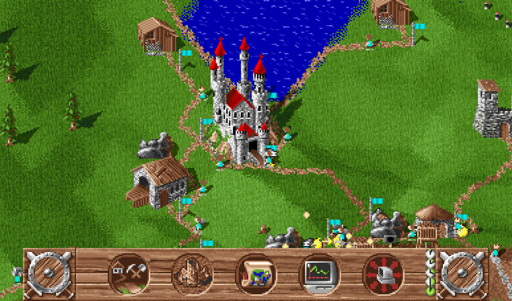
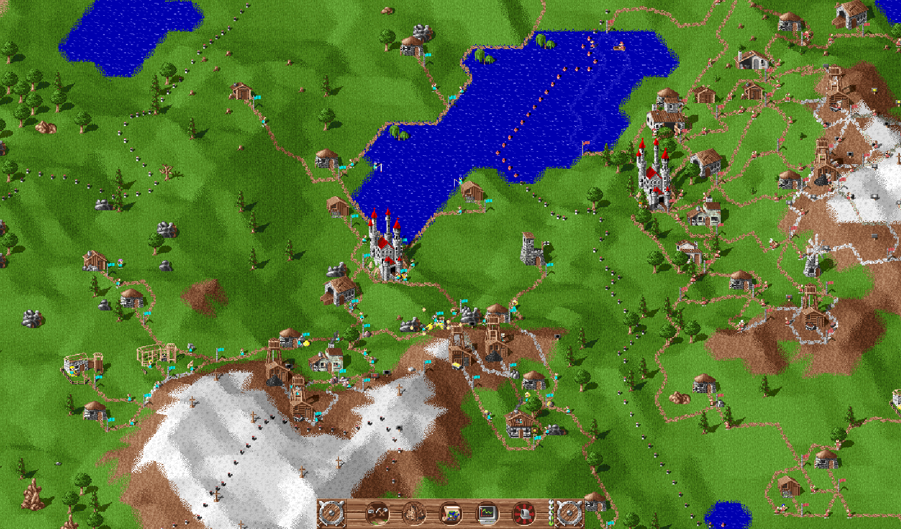

# webserf

A port of “The Settlers” (Blue Byte, 1993) in the browser.

The rules are ported from the original DOS program — its own machine code is the reference, not somebody's description of it. The graphics, sounds and music come straight from your own copy of the game files.

## Play it

**<https://www.webserf.org>** — open the page, drop in the graphics archive (`SPA*.PA`) from any 1993 installation you own, and you're in. Your archive and your saved games stay in your browser; nothing gets uploaded, and you don't need an account.

Nothing of the original is bundled here, so bring the file yourself.

## Quickstart

Never played it? Here's the idea: you don't command your settlers. You decide **what** gets built and **where**, you connect it all with roads — and the settlers carry, build and work on their own. Grow faster than your rivals; you win once you hold three quarters of the land and of the military strength.

### Controls

| | Mouse | Touch |
|---|---|---|
| Pick a spot, press an icon | left click | tap |
| Move the map | drag with the left button, hold the right button (like the original), or grab with the middle button | drag with one finger |
| Zoom | wheel or touchpad | pinch with two fingers |
| **Special click** — demolish, look inside buildings, send a geologist | hold right and click left, or Shift/Alt + left click | long press (half a second) |
| Pause, game speed | the settings panel on the left | the settings panel on the left |

The special click shows up everywhere below. Demolishing always needs it, so nothing burns down by accident.

### Your first steps

1. **Start a game.** Pick the first level in the main menu (its password is `START`) and press START.
2. **Place your castle.** Tap a flat, grassy spot with trees and grey boulders nearby. Not sure where it fits? Special-click the leftmost icon in the bottom bar: the construction help marks every possible site. When the castle icon appears bottom left, press it.
3. **Build inside your borders** (the black-and-white poles). Pick a spot; the icon bottom left tells you what fits there — a flag, a small building, a large one, or a mine. Press it and choose from the menu.
4. **Connect everything with roads.** Every building has a flag in front of it. Select a flag, press the road icon, then lay the road step by step to another flag. Green steps are flat, red ones steep — steep roads are slow. A building without a road gets nothing.
5. **Wood and stone first.** A lumberjack with a forester next to him, a stonecutter near the boulders, and a sawmill. Everything else is built from planks and stone.
6. **Grow.** Guard huts, towers and fortresses push your borders out as soon as a knight moves in.
7. **Then the long chains.** Fish, bread and meat feed your miners. Special-click a flag in the mountains to send a geologist looking for ore. Gold keeps your knights' spirits up.

### Tips

- Build your roads as a grid, not as a star around the castle — otherwise everything queues up at the castle gate.
- Keep buildings that work together close to each other: the sawmill next to the lumberjack, the mill next to the farm.
- When a little note blinks bottom left, something happened. Click or tap it and the map jumps there.
- The 1993 manual explains every building and every chain, if you want to go deeper.

## Features

- **Zoom, in a window of any size** — mouse wheel, touchpad or two fingers, from the whole world in one frame up to eight times pixel size.
- **Mouse or touch** — place, pull, push-scroll and the special click; on a tablet two fingers pan and zoom, and a long press stands in for the special click.
- **Speed and pause** — 0.25× to 8×; only the ticks per second of real time change, so a game stays reproducible at any of them.
- **Ten saved-game slots** — kept in this browser, and optionally mirrored into a folder as real `ARCHIV.DS` / `SAVE0..9.DS` files, which the original reads as they are. Import and export as a single file or a package.
- **Sound and music** — the effects and the FM-synth soundtrack, read from your archive.
- **German and English** — the game texts follow your archive, the frame around them follows your browser.
- **Installable, and it runs offline** — install it from the browser; archive and saved games are already local.
- **Screenshot and video** — a picture of the game screen, or a recording of it with the pointer.
- **Bug reports in one click** — game state, action log, screenshot and a summary, packed and ready to attach to an issue.
- **Levels, missions, free play** — campaign levels with their passwords, or a free game from a map seed code against computer opponents.

### Enhancements

Things the original never had. Every one of them is off until you switch it on, and the game rules stay untouched.

- **Stock overview** — a panel over the map with your goods, your settlers and the supply pointers of your production chains, all on one screen. You choose what it shows, where it sits and how see-through it is.
- **Hack: all minerals** — shows every deposit in the ground with the same sign a geologist would plant, including the ones no geologist will ever report.
- **Road assistant** — pick two of your flags and it builds the fastest road between them, using exactly the clicks you would make yourself.

| the map up close | pulled back |
|---|---|
|  |  |

Click a picture to see it full size.

## Play on several devices

Give webserf a folder for your saves and let a sync app — Syncthing, Nextcloud, Dropbox, whatever you use — keep that folder the same everywhere. Then you stop on your PC and carry on with the same game on your tablet.

1. **On every device, load your archive once.** It stays in that browser; the folder only carries your saves.
2. **Open *Import & export* → *Saved games* → *Choose a save folder*** and pick the synced folder.
3. **Save as usual.** The game writes `ARCHIV.DS` and `SAVE0..9.DS` into the folder.
4. **On the other device, let the sync app finish, then open LOAD.** The list is refreshed from the folder each time you open it, and again whenever you start webserf.

Good to know:

- **Per slot, the newer save wins.** Play on one device at a time, and keep the clocks of both devices right — a wrong clock can let the wrong save win.
- **You need Chrome or Edge**, on Android too. Firefox and Safari (so also the iPad) have no folder access; there your saves stay in the browser, and you move them with the download and import buttons on the same screen.
- **Android forgets the folder permission after a restart.** A mark on the rail on the left tells you; tap *Allow the remembered folder again* and you're back.
- **They're the original's own files.** Copy them into a DOSBox directory and the 1993 game loads them as they are.

## Thank you

To **Volker Wertich**, for designing the thing in the first place. Thirty years on, the economy still hums.

## How it was made

Built together with Claude Code — a collaboration between a human and a language model. 🤓

## Legal

“The Settlers” and everything in it belong to Blue Byte / Ubisoft. This is an independent hobby project with no connection to them — built out of admiration, and out of a slight inability to let 1993 go. No original game data is contained in this repository, and none is distributed with the application.
